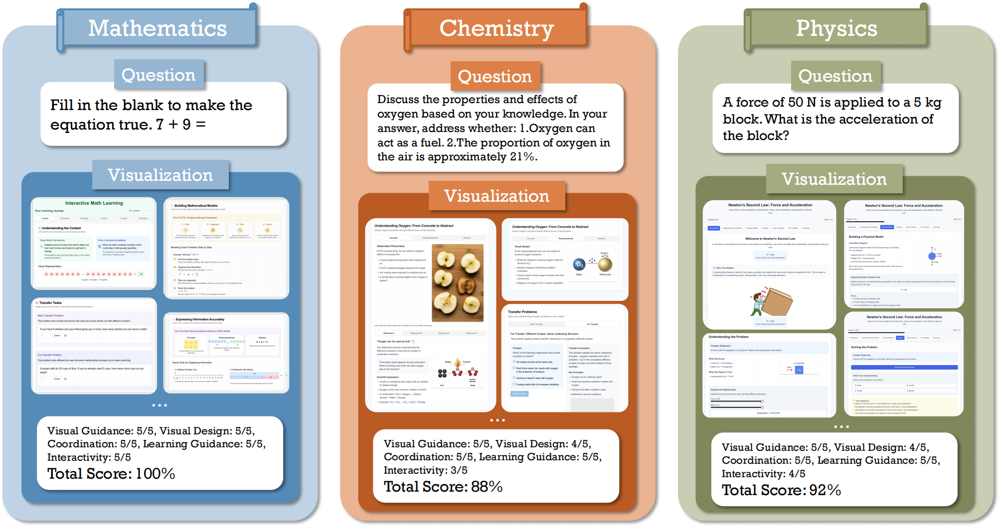

# EduVisAgent: A Benchmark and Multi-Agent Framework for Pedagogical Visualization

**Paper:** [From EduVisBench to EduVisAgent: A Benchmark and Multi-Agent Framework for Pedagogical Visualization](https://arxiv.org/abs/2505.16832)

## Overview

This project introduces **EduVisAgent**, a multi-agent framework designed to generate comprehensive educational visualizations from user queries, and **EduVisBench**, a benchmark for evaluating the quality of these visualizations. The system leverages a series of specialized language model (LM) agents that work collaboratively to create detailed teaching plans, improve them through iterative feedback, and build structured content for various presentation formats. The core of the system is the `TeachAgentsIntermediateSystem`, which coordinates the entire workflow.



## Features

- **Multi-Agent System:** A collaborative team of AI agents for generating educational content.
- **Iterative Refinement:** Agents provide feedback to each other to improve the quality of the generated content.
- **Structured Output:** Generates structured content suitable for various presentation formats.
- **Evaluation Benchmark (EduVisBench):** A comprehensive benchmark to assess the quality of pedagogical visualizations based on five key dimensions.

## Requirements

1. **Python 3.12**
2. **OpenAI API Key**
3. **Conda** (recommended for environment management)

## Installation

1. **Clone the repository:**
   ```bash
   git clone https://github.com/aiming-lab/EduVisAgent
   cd EduVisAgent
   ```

2. **Create and activate Conda environment:**
   ```bash
   conda create -n eduvis python=3.12
   conda activate eduvis
   ```

3. **Install dependencies:**
   ```bash
   bash install.sh
   ```

4. **Set up environment variables:**
   Export your OpenAI API key as an environment variable in your terminal session. 
   ```bash
   export OPENAI_API_KEY="your_openai_api_key_here"
   ```

## Usage

### Generating Educational Visualizations

Execute the main script to run the educational content generation system:

```bash
python scripts/run_teach_intermediate.py --question "Your educational question here"
```

By default, if no `--question` argument is provided, the script uses a predefined example query. 

Output will be saved in the `outputs/teach_intermediate/` directory, with subdirectory names containing a timestamp and a brief description of the query (e.g., `outputs/teach_intermediate/YYYYMMDD_HHMMSS_explain_concept_photosynthesis/`).

### Batch Processing of Educational Questions

For processing multiple educational questions from a dataset (e.g., `train.jsonl`), you can use the `run_teach_intermediate_batch.py` script. This script iterates through questions in a JSONL file and runs the full `TeachAgentsIntermediateSystem` for each.

```bash
python scripts/run_teach_intermediate_batch.py --data_file mydatasets/train.jsonl --limit 5
```

### Evaluating Visualizations with EduVisBench

To evaluate visualizations against the benchmark, simply run the evaluation script:

   ```bash
   python evaluation/run_evaluation.py
   ```

   The script will automatically check for the EduVisBench dataset. If it's not found locally, it will be downloaded from Hugging Face before the evaluation begins. This includes the necessary JSON data and images.


## Dataset

The EduVisBench dataset is automatically downloaded from the [Haonian/EduVisBench](https://huggingface.co/datasets/Haonian/EduVisBench) repository on Hugging Face when you run the evaluation script for the first time. For a detailed description of the dataset, including its structure, statistics, and data sources, please see [`DATASET.md`](./DATASET.md).

## Directory Structure

```
EduVisAgent/
├── agents/                         # Core agent logic
├── config/                         # Configuration files
├── evaluation/                     # Evaluation scripts and data
│   ├── data/                       # Benchmark data (auto-downloaded)
│   └── run_evaluation.py           # Script for running EduVisBench evaluation
├── image/                          # Image resources for README
├── models/                         # Language model interfaces
├── mydatasets/                     # Directory for custom user datasets
├── scripts/                        # Main executable scripts
├── utils/                          # Utility functions and classes
├── install.sh                      # Installation script
└── README.md                       # This file
```

## Citation

If you find this work useful, please cite our paper:

```bibtex
@article{ji2025eduvisbench,
  title={From EduVisBench to EduVisAgent: A Benchmark and Multi-Agent Framework for Pedagogical Visualization},
  author={Ji, Haonian and Qiu, Shi and Xin, Siyang and Han, Siwei and Chen, Zhaorun and Wang, Hongyi and Zhang, Dake and Yao, Huaxiu},
  journal={arXiv preprint arXiv:2505.16832},
  year={2025}
}
```
